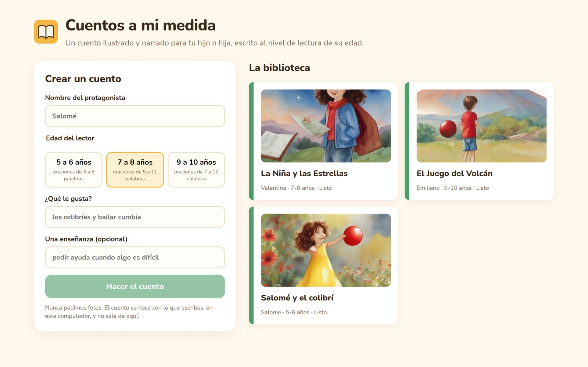
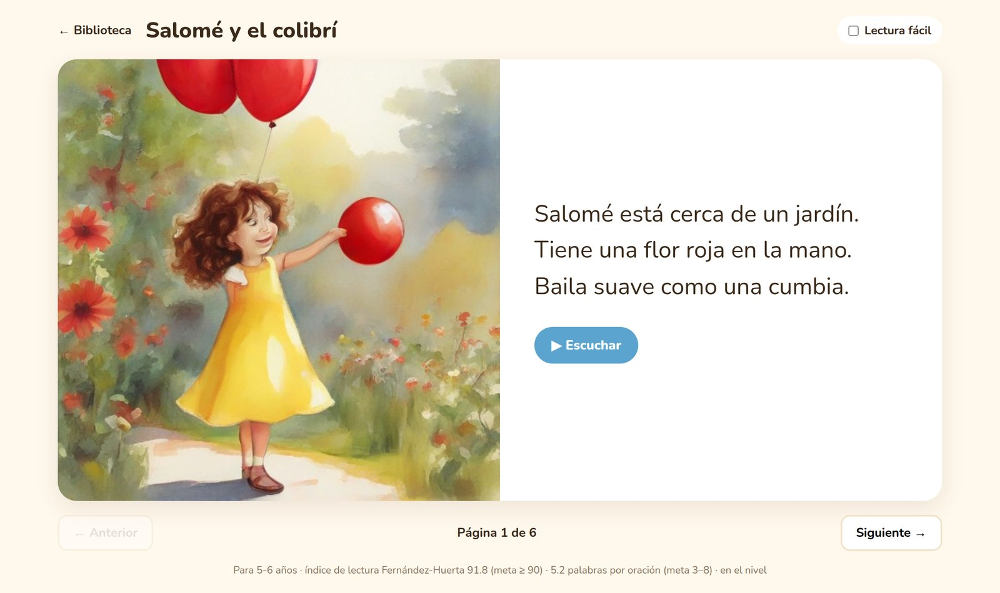
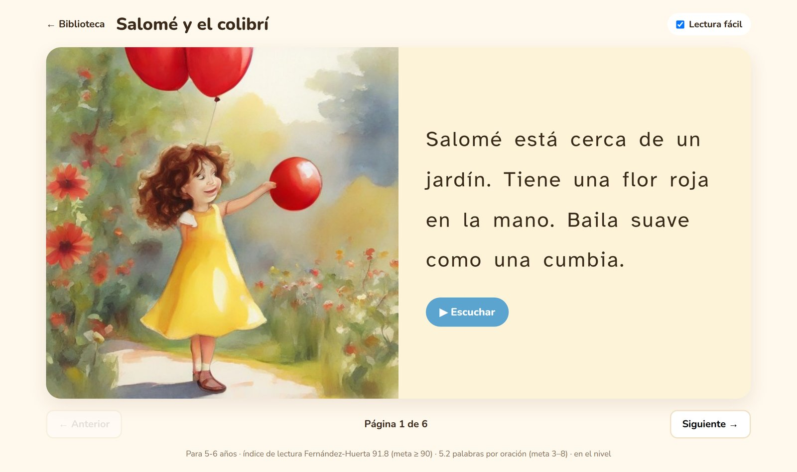

# cuentos-a-mi-medida

**Illustrated, narrated stories in Spanish for one particular child: their name, what they love, and written at the
reading level of their age, measured, not hoped for.** A reproduction of Adversarial Diffusion Distillation (the method
behind SDXL-Turbo) on a single RTX 4060, then a product built on it, where every claim (reading level, the same hero on
every page, the request filter) has a number behind it. Everything runs on one PC; it never asks for a photo of the
child.



## The paper, and what I added

**Adversarial Diffusion Distillation** (Sauer, Lorenz, Blattmann & Rombach, ECCV 2024,
[arXiv:2311.17042](https://arxiv.org/abs/2311.17042)). A diffusion model is distilled into a student that draws in one
to four steps, trained with two signals at once: an adversarial loss from a discriminator on DINOv2 features, and a
distillation loss toward the teacher's denoised prediction. The paper's claims: one-step ADD-XL beats four-step LCM-XL;
four-step ADD-XL beats its teacher SDXL in most human comparisons; and its samples are less diverse.

I checked those claims on the released models with the paper's benchmark scaled to one 8 GB card (1,000 COCO
captions; CLIP ViT-g-14 as in the paper; PickScore in place of the user study), then built the story app around
SDXL-Turbo:

1. **Reading level, measured and corrected.** Every story is scored with the Fernández-Huerta index (the Spanish
   Flesch) and words per sentence against a target per age band; off-target stories are rewritten with concrete
   feedback.
2. **The same hero on every page.** The LLM writes a fixed visual description of the hero that goes into every page's
   prompt, with the same style and seed; measured on DINOv2 features against scene-only prompts.
3. **A request gate.** A word list for the blunt cases and an LLM checklist for the rest, measured on a set written
   before the final prompt was run. Generated images also pass an NSFW classifier.
4. **Reading together.** Narration with Piper (a Mexican Spanish voice) where the sentence being read lights up, and
   an easy-reading mode with Atkinson Hyperlegible, wide spacing and a cream background.

## What came out

**1. All three ADD claims reproduce** ([results/reproduction](results/reproduction)).

| | steps | s / image | CLIP ↑ | PickScore ↑ | diversity ↑ |
|---|---:|---:|---:|---:|---:|
| SDXL-Turbo (ADD-XL) | 1 | **0.23** | **0.339** | 22.54 | 0.549 |
| SDXL-Turbo (ADD-XL) | 4 | 0.47 | 0.338 | **22.64** | 0.574 |
| LCM-SDXL | 4 | 6.1\* | 0.326 | 22.14 | 0.579 |
| SDXL 1.0 base (teacher) | 25 | 18.7\* | 0.334 | 22.26 | **0.605** |

One step of SDXL-Turbo beats four of LCM-SDXL; four steps beat the teacher on PickScore; and its samples are less
diverse (LPIPS between four seeds). FID goes the teacher's way, as the paper itself anticipates. \*1024 px with CPU
offload on 8 GB; SDXL-Turbo at 512 px.

**2. Measuring and rewriting puts 71% of stories at the reading level** ([results/readability](results/readability)).
24 requests across three age bands, Qwen3-4B-Instruct: 42% on target with the age in the prompt, 58% keeping the best
of three, 71% measuring and rewriting with feedback. What made it possible was asking for each page as a list of
sentences with a word range each: with free text the model wrote 4–5 words per sentence for every age, and stories
for 9–10 year olds were never on target.

**3. The character sheet keeps the hero recognisable** ([results/consistency](results/consistency)). Page-to-page
similarity of 0.60 against 0.45 without it, better in 12 of 12 stories, at a small cost in scene fidelity (0.266 vs
0.288).


**4. The request gate blocks 80% of inappropriate requests and no fine ones** ([results/safety](results/safety)), on
20 + 20 requests written before the final prompt ever ran, most with no word a list would catch ("abrirle la puerta a
cualquiera", "darle chocolate al perro"). Asking the same model "can an appropriate story be written from this?"
blocked none of them: any topic can be turned into a cautionary tale.

| | |
|---|---|
|  |  |

## How it works

```
parent ──> Next.js ──> FastAPI ──> request gate (word list, then LLM checklist) ──> 422 with the reason, in Spanish
                          │
                          └──> DynamoDB (library) + SQS (jobs, dead-letter after 3 tries)
                                                        │
                       GPU worker <─────────────────────┘
                         1. write: Qwen3-4B (Ollama), JSON schema, Fernández-Huerta + sentence band, rewrite
                         2. draw: SDXL-Turbo, 1 step, character sheet + seed, NSFW check and redraw
                         3. narrate: Piper es_MX, one cue per sentence
                         └──> S3 (pictures, audio) + DynamoDB (status, pages, reading level)
reader <── presigned S3 links <── FastAPI
```

- **Clean architecture:** `domain` (readability, story, safety rules) is plain Python; `application` (storyteller,
  illustrator, narrator, moderation, bookmaker) talks to `ports`; `adapters` are Ollama, diffusers, Piper and AWS;
  `entrypoints` are the API and the worker. Tests run on fakes in under a second.
- **Readability** (`domain/readability.py`): rule-based Spanish syllabification (diphthongs, hiatus, accented weak
  vowels, silent *u*, final *y*), the index, the age bands, and a distance to the target used to keep the best draft.
- **One GPU, one worker:** the LLM unloads after every call so SDXL-Turbo can have the card; SDXL's two text encoders
  stay on the CPU and only the UNet and the VAE sit on the GPU (5.6 GB peak, next to the desktop). A book takes 1–3
  minutes on this machine, mostly the LLM on the CPU.
- **AWS, locally:** S3 (public access blocked, one-year lifecycle), DynamoDB and SQS with a dead-letter queue, written
  in Terraform and applied to LocalStack. The adapter talks to them with boto3; dropping `AWS_ENDPOINT_URL` points it
  at a real account.
- **Next.js reader**, in Spanish for its readers: big type, one page at a time, narration with sentence highlighting,
  the easy-reading toggle, and the measured reading level under each story.
- **Jenkins:** lint and tests (JUnit report), web lint and build, `terraform fmt`/`validate`/`plan` and apply to
  LocalStack, the benchmarks on demand, and a quality gate that fails the build if stories stop landing on target, the
  request gate weakens, or the character sheet stops helping (`quality_gate.json`).

## Run it

```bash
uv sync --group repro
./run.sh voice                 # the Piper voice
ollama pull qwen3:4b-instruct  # and keep `ollama serve` running
./run.sh infra                 # LocalStack + terraform apply
./run.sh worker                # the GPU worker
./run.sh api                   # http://localhost:8002
./run.sh web                   # http://localhost:3002
./run.sh test
./run.sh reproduce             # the ADD reproduction (about 7 hours)
./run.sh readability           # or consistency, safety, gate
```

## What didn't work, and what to keep in mind

- **The usual Fernández-Huerta formula is cited wrong.** Many sources give F as sentences per 100 words, which makes
  longer sentences *easier*. The 1959 adaptation of Flesch uses words per sentence; with the other version, short
  sentences scored as harder, the opposite of what a beginning reader needs.
- **The index alone is gameable.** A small model hit 100 with telegraphic text ("Ana ve. Ana ríe."). The target is the
  index plus a band of words per sentence per age.
- **Rewriting made some stories worse.** Asked to fix one thing, the model broke another. The app keeps the draft
  closest to the target, not the last one, and the feedback quotes the offending sentences instead of restating the
  goal.
- **Free text could not be steered.** Writing each page as prose, the 4B model stayed at 4–5 words per sentence for
  every age, whatever the prompt said; a JSON list of three sentences with a word range each moved it. The two runs are both in
  [results/readability](results/readability).
- **A story in English.** Asked for English scene descriptions, the model sometimes wrote the whole story in English.
  The schema's field names are now in Spanish, a story must be at least 80% Spanish words, and one in English is sent
  back.
- **The first safety prompts failed in two different ways.** The open question let almost everything through. The
  first checklist asked for a free-text reason; the model kept writing it until the token limit and the JSON came back
  cut, so the request was refused, and 48% of fine requests ("los dinosaurios") were blocked. Ollama also writes
  keys in alphabetical order, so the categories after the reason were never reached. The reason is now a capped
  "analisis" field that sorts first.
- **CLIP reads 77 tokens.** With the style first and the scene last, the scene was cut off in 28 of 72 prompts. The
  scene now goes before the character sheet.
- **SDXL-Turbo whole doesn't fit next to the desktop on 8 GB** (6.5 GB in fp16). The reproduction encodes all captions
  first and keeps only the UNet and the VAE on the GPU; the worker keeps the text encoders on the CPU (1.4 s per
  picture instead of 0.2).
- **SD 2.1, SD-Turbo's teacher, is gone from Stability's Hugging Face page**, so only SDXL-Turbo is compared with its
  teacher.
- **Library drift:** clean-fid still calls `scipy.linalg.sqrtm(disp=...)`, removed in recent SciPy (pinned below 1.18),
  and transformers 5 returns an output object from `get_image_features`. LocalStack images after 4.10 need an auth
  token (pinned). Next.js 16.4.0 had critical advisories (moved to 16.4.2).
- **Still off target sometimes.** 29% of stories miss the band after three drafts; the reader says so under the story
  ("fuera del nivel") instead of hiding it. The request gate misses prejudice phrased as an opinion and things a 4B
  model doesn't know are dangerous (chocolate for dogs).
- **Moderation on the CPU takes tens of seconds**, which a parent feels; on a second GPU, or with a small dedicated
  classifier, it would take about a second.

## Credits and licenses

- Sauer, Lorenz, Blattmann & Rombach, *Adversarial Diffusion Distillation*, ECCV 2024.
- Fernández Huerta, *Medidas sencillas de lecturabilidad*, Consigna 214, 1959.
- SDXL-Turbo and SD-Turbo: Stability AI, non-commercial community license. SDXL 1.0 and LCM-SDXL: OpenRAIL++. The
  fp16 SDXL VAE by madebyollin.
- CLIP ViT-g-14 (LAION-2B, OpenCLIP), PickScore_v1 (Kirstain et al., 2023), DINOv2 (Meta, Apache-2.0), LPIPS,
  clean-fid; Falconsai/nsfw_image_detection (Apache-2.0).
- Qwen3-4B-Instruct (Apache-2.0) via Ollama; Piper with the es_MX "ald" voice.
- COCO 2017 captions (CC BY 4.0), used for the reproduction only and not redistributed.
- Atkinson Hyperlegible (Braille Institute, OFL) and Nunito (OFL).
- Code: MIT. Because SDXL-Turbo is non-commercial, the app as configured is for research and personal use.
