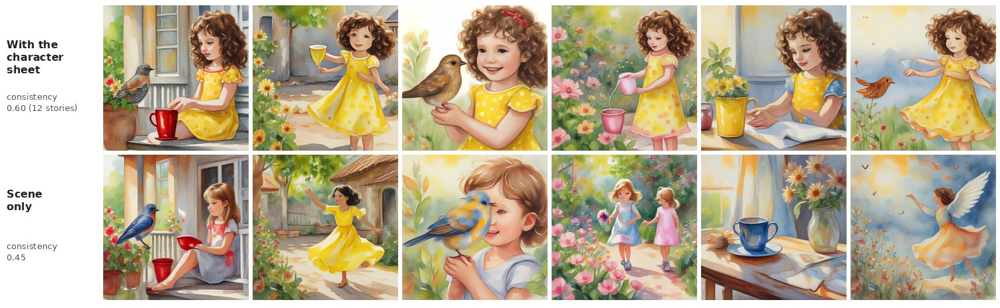

# The same hero on every page

SDXL-Turbo draws each page on its own, so with only the scene in the prompt the hero changes hair, clothes and age from
page to page. When the LLM writes the story it also writes a **character sheet**: a fixed visual description of the
hero in English (age, hair, clothes, one identifying detail). Every page's prompt carries it, with the same style and
the same seed.

12 stories (6 pages each), illustrated twice with the same seeds: with the sheet and with the scene alone.

| | consistency ↑ | scene fidelity ↑ |
|---|---:|---:|
| scene only | 0.450 | **0.288** |
| scene + character sheet | **0.596** | 0.266 |

The sheet makes the pages more alike in **12 of 12** stories.

- **Consistency:** mean cosine similarity between every pair of pages of a story, on DINOv2-small features, which
  respond to how something looks more than to what it is.
- **Scene fidelity:** CLIP ViT-L/14 similarity between each page and its own scene text. It guards against the cheap
  way to be consistent, drawing the same picture six times.

The sheet costs some scene fidelity: part of each 77-token prompt now describes the hero instead of the scene. The
first version put the style first and the scene last; CLIP cut the scene off in 28 of 72 prompts, and fidelity fell
from 0.288 to 0.259. With a shorter style and the scene before the sheet, no scene is cut (the end of the sheet still
is in 12 of 72), and the gap closed to 0.288 vs 0.266 while consistency stayed near 0.60 (0.611 before, 0.596 now). The raw rows are in
[summary.json](summary.json).

Rerun: `./run.sh consistency` (a few minutes on the GPU once the 12 stories are written).
