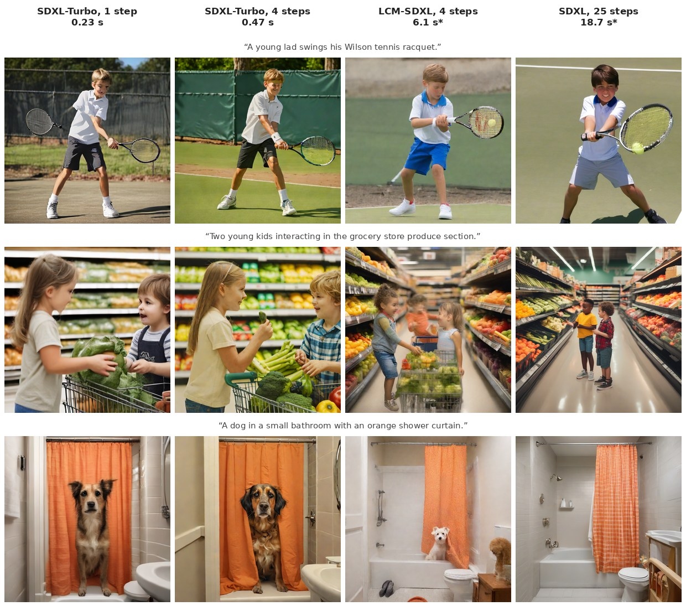

# Reproducing Adversarial Diffusion Distillation on one RTX 4060

Sauer, Lorenz, Blattmann & Rombach, *Adversarial Diffusion Distillation*, ECCV 2024
([arXiv:2311.17042](https://arxiv.org/abs/2311.17042)). ADD is the method behind SDXL-Turbo and SD-Turbo. I did not
retrain it: one 8 GB card can't. I checked the paper's three claims on the released models, with the paper's
benchmark (COCO 2017 captions, CLIP ViT-g-14) cut down to what fits on this card.

| | steps | size | s / image | CLIP ↑ | PickScore ↑ | FID-1k ↓ | KID-1k ↓ | diversity ↑ |
|---|---:|---:|---:|---:|---:|---:|---:|---:|
| SDXL-Turbo (ADD-XL) | 1 | 512 | **0.23** | **0.339** | 22.54 | 70.3 | 0.0092 | 0.549 |
| SDXL-Turbo (ADD-XL) | 4 | 512 | 0.47 | 0.338 | **22.64** | 68.9 | 0.0084 | 0.574 |
| SD-Turbo (ADD-M) | 1 | 512 | 0.20 | 0.330 | 22.12 | 67.8 | 0.0068 | 0.558 |
| LCM-SDXL | 4 | 1024 | 6.06* | 0.326 | 22.14 | 66.6 | 0.0070 | 0.579 |
| SDXL 1.0 base (teacher) | 25 | 1024 | 18.7* | 0.334 | 22.26 | **64.6** | **0.0038** | **0.605** |

1,000 captions from COCO 2017 val (one per image, shuffled with a fixed seed), one image each; diversity on 50 of
them with 4 seeds each. Raw numbers: [coco_1k.json](coco_1k.json).

## The claims

1. **"ADD-XL with one step beats LCM-XL with four."** Reproduced on both automatic proxies: CLIP score 0.339 vs 0.326,
   PickScore 22.54 vs 22.14, at 0.23 s against 6 s.
2. **"With four steps, ADD-XL beats its teacher SDXL"** (the paper: in most human comparisons against SDXL at 50
   steps). Reproduced with PickScore as the stand-in for people: 22.64 vs 22.26; CLIP 0.338 vs 0.334.
3. **"ADD-XL's sample diversity tends to be lower."** Reproduced: mean LPIPS between four seeds of the same caption is
   0.549 (1 step) and 0.574 (4 steps) against the teacher's 0.605. The grid shows it too: one and four steps from the
   same seed give nearly the same picture.

FID goes the other way: the teacher has the best FID and KID and SDXL-Turbo the worst. The paper anticipates this:
its Table 1 discussion notes that students take on their teacher's traits and that SDXL scores higher FID despite
better image quality, possibly because its output is less diverse. FID rewards matching the spread of real photos,
which is exactly what ADD trades away.

## What is not the paper's setup

- **1k samples, not 5k.** FID is biased upward at 1k, so these FIDs only compare the models with each other; they are
  not comparable with the paper's FID-5k. KID is unbiased at this size and orders the models almost the same way (only SD-Turbo and LCM-SDXL swap).
- **Teacher at 25 steps, not 50**, to keep its 1,200 images under seven hours.
- **PickScore instead of a user study.** PickScore_v1 is a CLIP-H model trained on the Pick-a-Pic human preferences:
  a proxy, not people. The differences between models are small (a few tenths) and I did not test them for
  significance.
- **Times are not like-for-like.** SDXL-Turbo runs at 512 px with only the UNet and the VAE on the GPU (its prompts are
  encoded beforehand); LCM-SDXL and SDXL run at 1024 px with model CPU offload, because the whole pipeline doesn't fit
  next to the desktop on 8 GB (marked \*). The order of magnitude holds; the exact ratio would be smaller on a bigger
  card.
- **SD 2.1**, SD-Turbo's teacher, is no longer on Stability's Hugging Face page, so SD-Turbo is shown without its own
  teacher.
- Everything compared at 512 px: real COCO images center-cropped, 1024 px outputs downsized.

Rerun: `./run.sh reproduce` (about 7 hours on an RTX 4060, almost all of it SDXL at 25 steps, then about 45 minutes of
scoring).
